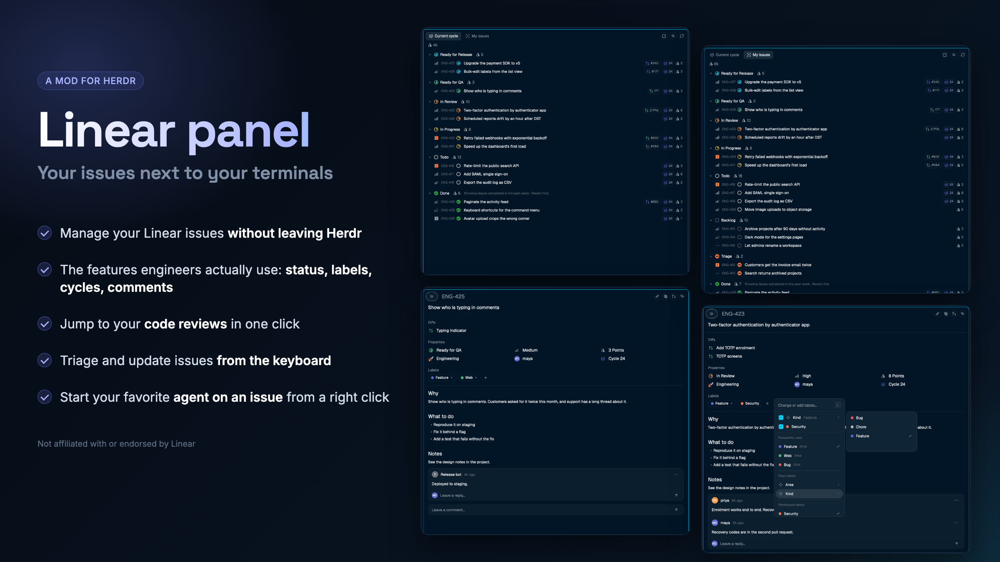

# herdr-linear-panel

A mod for the [Herdr](https://herdr.dev) app that shows the Linear issues assigned to you in a side panel, beside your
terminals.



- Switch between two views of your issues, the current cycle and all of them, each grouped by status in Linear's
  order.
- Click an issue to open its page in the panel. You can edit its title in place, change its properties and labels,
  read its description, and write, reply to, edit, resolve or delete comments. Deleting a comment asks first.
- Change an issue's status, priority, assignee, estimate, cycle or labels from its row, its page, its menu or the
  keyboard, or drag the row to another status. Pickers open beside the control you press; type to filter them, and
  use the arrow keys and Enter to pick.
- Each row shows the issue's merge requests, merged or not, and one click opens them all.
- Hover an issue's status to see how long it has spent in each status. Hover its cycle to see the cycle's capacity,
  how much of it is done and how many weekdays are left.
- Select several issues (tick their boxes) and change them together from the command window (`Cmd+K`).
- Copy one issue or several as IDs, links, Markdown, a prompt for an agent, or a list of their merge request links.
- Start work on an issue: the mod checks out the issue's branch in a new git worktree, opens a Herdr space there, and
  starts your agent with the issue as its first message.

## Install

Ask the coding agent in a Herdr terminal (Claude Code, Codex) to add the mod from this repository. The agent copies
`mods/linear-panel` into your Herdr folder and adds two blocks to your layout: the panel, and its button in the top
bar. To install by hand, copy `mods/linear-panel` into `~/.config/herdr-app/mods/`, then add the two blocks from the
Layout paragraph of the [recipe](RECIPE.md) to your layout.

The mod targets macOS, Linux and Windows; only macOS is tested.

### A ready-made layout

The mod ships an example layout, `mods/linear-panel/examples/main-linear.json`: Herdr's `main` layout with both
blocks in place. Once the mod is installed, copy the example into your layouts and switch to it:

```sh
cp ~/.config/herdr-app/mods/linear-panel/examples/main-linear.json ~/.config/herdr-app/layouts/
herdr-app do layout.switch '{"name":"main-linear"}'
```

`ctrl-shift-l` switches back to your own layout. The example copies `main` from Herdr 0.1.16; on a later Herdr, clone
your own `main` and add the two blocks instead.

The example's panel block also sets `pre_linear_issue_prompt` and `post_linear_issue_prompt` to placeholder text.
When you start an issue, that text opens and closes your agent's first message, so replace it with your own or delete
both settings (see Settings).

## API key

Until it finds a key, the panel shows these steps.

1. In Linear, create a personal API key under Settings, Account, Security and access. Give it write access: the
   panel needs it to change an issue.
2. Give the key to the mod from a terminal:

   ```sh
   # macOS: the Keychain (prompts for the key)
   security add-generic-password -U -a "$USER" -s herdr-linear -w
   # Linux: the keyring (prompts for the key)
   secret-tool store --label="Linear API key" service herdr-linear
   # Windows: a variable, with your key in place of KEY; then restart Herdr
   setx LINEAR_API_KEY KEY
   ```

   On macOS and Linux you can export `LINEAR_API_KEY` instead.

The mod reads the key from there once and keeps it in memory until Linear rejects it. It never writes the key
anywhere.

## Keys

Click in the panel so it receives your keys. One row is highlighted at a time: the one under the pointer, or the last
one you reached with the arrow keys. Keys that act on a single issue act on that row.

| Key | Does |
| --- | --- |
| `↑`, `↓` | Highlight the issue above or below |
| `Enter` | Open the highlighted issue's page |
| `1`, `2` | Show the Current cycle view, or the My issues view |
| `C` | Open Linear's composer for a new issue |
| `R` | Reload the issues, teams and labels |
| `Shift+V` | Open the display options |
| `X` | Select the highlighted issue; with `Shift`, every issue from the last one selected to it |
| `S`, `P`, `A`, `Shift+E`, `Shift+C` | Change the status, priority, assignee, estimate or cycle of the selected issues, or else of the highlighted issue or the open issue |
| `I` | Unassign the selected issues, or else the highlighted issue |
| `Cmd+K` | Open the command window on the selected issues |
| `Esc` | Clear the selection, or close the issue's page |
| `L` | Change the open issue's labels |
| `Cmd+Shift+M` | Move the open issue to another team |

The copy shortcuts match Linear's. They copy the selected issues, or else the highlighted one:

| Key | Copies |
| --- | --- |
| `Cmd+.` | The ID |
| `Cmd+Shift+,` | The URL |
| `Cmd+Shift+'` | The title |
| `Cmd+C` | The title as a link |
| `Cmd+Shift+.` | The git branch name |
| `Cmd+Alt+M` | The issue as Markdown |
| `Cmd+Alt+C` | The issue and its comments as Markdown |
| `Cmd+Alt+X` | The links to its merge requests |
| `Cmd+Alt+P` | The issue as a prompt for an agent (one issue only) |

Off macOS, `Cmd` is `Ctrl`. On macOS, `Alt` is `Option`.

## Settings

The panel reads its settings from its block in your layout (`layouts/<name>.json` in your Herdr folder), under
`props`:

```json
{ "mod": "linear-panel", "props": {
    "agent": "codex",
    "pre_linear_issue_prompt": ["Before you start on the issue below:", "1. Work in this worktree only."],
    "post_linear_issue_prompt": ["Once you have read the issue:", "1. Plan before you write code."] } }
```

- `agent`: which agent Start launches, by its key in Herdr's programs (`claude`, `codex`, or one you added to
  `programs.json`). Without it, Start launches the installed agent you start most often.
- `pre_linear_issue_prompt`: text placed at the start of the agent's first message, as one string or a list of lines.
  The message continues with what you type when you start the issue, then the issue itself, formatted as "Copy as
  prompt" formats it. The old name, `start_prompt`, still works.
- `post_linear_issue_prompt`: text placed at the end of that message, after the issue, in the same form. Use it for
  what the agent should do once it has read the issue.
- `api`: an address the panel calls instead of Linear's API, such as a stand-in that serves made-up issues for a demo
  or a screenshot. The panel sends your API key to that address, so name only a server you run. It must be an https
  address, or an http one on this computer (`localhost`, `127.0.0.1`, `[::1]`); otherwise the panel shows an error
  and sends nothing.

## Colors

The panel draws with your Herdr theme. To match your Linear theme, set the colors in your own `settings.json`, not in
the mod:

```json
"colors": { "accent": "#00D3FE", "background": "#011526" }
```

## Development

The mod is plain JavaScript typed through JSDoc: `types.d.ts` declares the shapes, JSDoc comments name them, and the
TypeScript compiler checks every file. The tests need Node 26 or later and no packages. TypeScript and ESLint, for the
type check and the linter, are dev dependencies; pnpm installs them and waits ten days before taking any new release
(`pnpm-workspace.yaml`).

```sh
pnpm install        # once: TypeScript and ESLint, for the two checks below
pnpm test           # unit tests, and every part driven in a stand-in for Herdr
pnpm run typecheck  # the strict TypeScript check; needs gpui-kit.d.ts, which Herdr writes into the mod's folder
pnpm run lint       # ESLint: its recommended rules, two-space indent, one call per line in a method chain, and
                    # names spelled out (no single letters, no `cx` for a context)
pnpm run check      # Herdr's own check of the mod
pnpm run link       # link mods/linear-panel into your Herdr folder, once
pnpm run reload     # make Herdr load your changes
pnpm run shot       # save a picture of Herdr's window in .scratch/, to compare a change before and after
```

Herdr does not watch a linked folder for changes, so run `pnpm run reload` after each change. When Herdr is
installed, the tests' stand-in for Herdr reads its `gpui-kit.d.ts` and fails on any element method Herdr doesn't
have.

```
mods/linear-panel/
  main.js       picks the part a copy of the mod shows
  mod.json      the mod's title and place
  config.js     sizes, timings, paths and option lists
  enums.js      the closed sets of strings the mod passes around
  actions.js    copying an issue, and starting work on it
  dock.js       where the panel sits in the layout
  parts/        the panel (panel.js holds it, panel-view.js draws it, requests.js does its work, loader.js loads),
                the issue list and page (comments.js holds its comments), its button and each popup
  lib/          the rules, free of Herdr, tested by node (`sanitize.js` cleans what the tracker sends)
  tracker.js    everything that names Linear
  api.js        the GraphQL queries
  ui.js         the shared building blocks: pill rows, buttons, marks, key caps
  style.js      the scale of text sizes, gaps, corners and heights, and the theme's colors by purpose
  channel.js    how the popups ask the panel for work
  popups.js     every popup's size, place and props
  types.d.ts    the shapes the files pass around, for the type check
  icons/        the mod's own icons, and a few from Lucide
  examples/     a layout with the panel and its button in place
  brand/        Linear's logo, with its notice
tests/
  fixtures.js   the made-up issues and the stand-in tracker
  host/         the stand-in for Herdr
  unit/         tests of lib/, of the repository's style, and of how its files import each other
  parts/        tests of the parts: clicks, keys, drags
```

CI runs the linter, the type check and the tests on every push to `main` and every pull request
(`.github/workflows/test.yml`). CI has no Herdr, so it uses the copy of Herdr's `gpui-kit.d.ts` in `vendor/herdr/`,
taken from Herdr 0.1.18. After a Herdr update, refresh it: `cp mods/linear-panel/gpui-kit.d.ts vendor/herdr/`.

The [changelog](CHANGELOG.md) lists what changed. The version in `package.json` is the date of the latest changelog
entry, so a bug report can name the version it was seen in.

## Icons

These icons come unchanged from [Lucide](https://lucide.dev) 1.82.0, under the ISC and MIT licenses in
`LUCIDE-LICENSE.txt`: `clipboard.svg`, `external-link.svg`, `refresh.svg`, `sort-down.svg`, `sort-up.svg`,
`git-merge.svg`, `git-pull-request.svg`, `git-pull-request-draft.svg` and `git-pull-request-closed.svg`. Here
`refresh.svg` is Lucide's `refresh-cw`, `sort-down.svg` its `arrow-down-wide-narrow` and `sort-up.svg` its
`arrow-up-narrow-wide`.

## Trademarks

Linear and the Linear logo are trademarks of Linear. The logo files in `mods/linear-panel/brand` come unchanged from
Linear's brand assets (<https://linear.app/brand>), and the MIT license does not cover them. This project is not
affiliated with or endorsed by Linear.

## License

[MIT](LICENSE). The icons from Lucide keep their own licenses (`mods/linear-panel/icons/LUCIDE-LICENSE.txt`).
