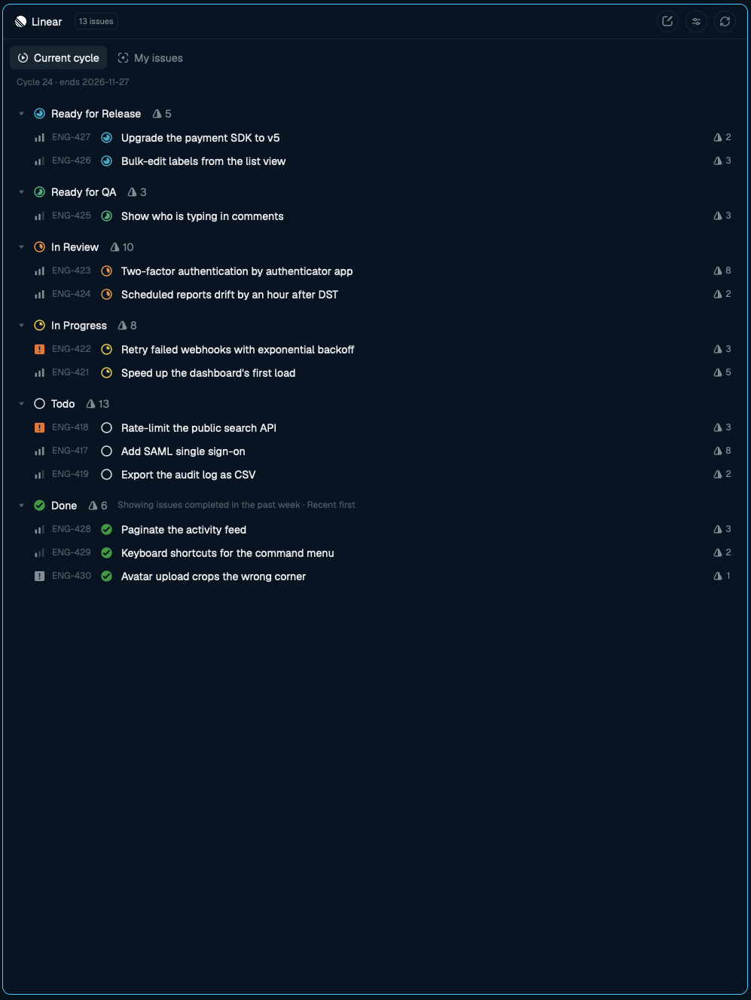
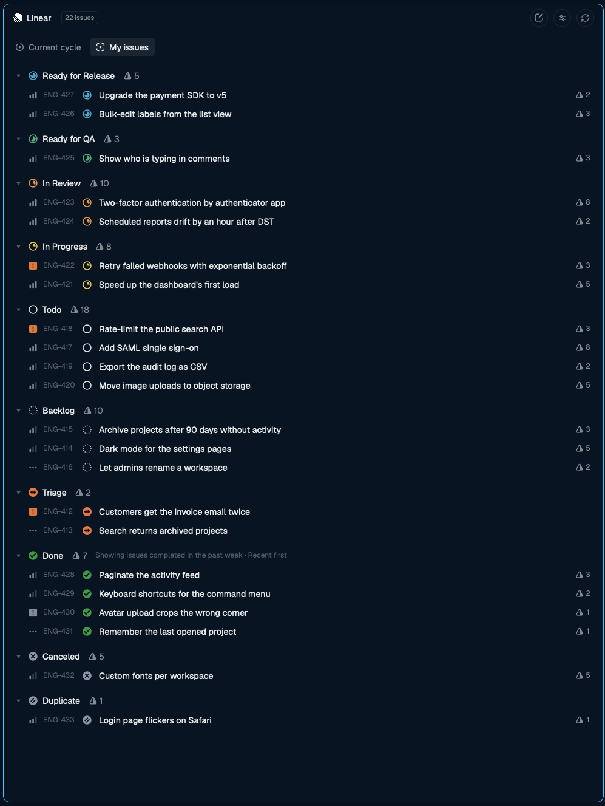

# herdr-linear-panel

A mod for the [Herdr](https://herdr.dev) app: the Linear issues assigned to you, in a side panel beside your terminals.

This project is not affiliated with or endorsed by Linear.

| Current cycle | My issues |
| --- | --- |
|  |  |

- Two views, the current cycle and all your issues, grouped by status and ordered as Linear orders them.
- Change an issue's status, priority, assignee or estimate from its row, its menu, or the keyboard. Drag a row to
  another status.
- Rest the pointer on an issue's status to see how long the issue has been in each status.
- Tick several issues and change them together from a command window (`Cmd+K`).
- Copy one issue or several as IDs, links, Markdown or a prompt.
- Start work on an issue: a git worktree on its branch, a new space there, and your agent briefed with the issue.


## Install

Ask the agent in your Herdr window to add the mod from this repository. It copies `mods/linear-panel` into your Herdr
folder and adds two blocks to your layout: the panel, and its button in the top bar. The "Layout" paragraph of the
[recipe](RECIPE.md) lists both.

It is written for macOS, Linux and Windows, although only macOS has been actively tested.

## API key

The panel shows these steps until it finds a key.

1. Create a personal API key in Linear, under Settings, Account, Security and access. Changing an issue needs write
   access.
2. Give it to the mod, from a terminal:

   ```sh
   # macOS: the Keychain (prompts for the key)
   security add-generic-password -U -a "$USER" -s herdr-linear -w
   # Linux: the keyring (prompts for the key)
   secret-tool store --label="Linear API key" service herdr-linear
   # Windows: a variable, with your key in place of KEY; then restart Herdr
   setx LINEAR_API_KEY KEY
   ```

   On macOS and Linux you can export `LINEAR_API_KEY` instead.

The key stays there. The mod reads it for each request and stores nothing.

## Keys

Click in the panel first: it then has the keyboard.

| Key | Does |
| --- | --- |
| `1`, `2` | Current cycle, My issues |
| `C` | New issue |
| `R` | Reload |
| `Shift+V` | Display options |
| `X` | Tick the issue under the pointer; with `Shift`, every issue from the last one ticked to it |
| `S`, `P`, `A`, `Shift+E` | Status, priority, assignee, estimate of the ticked issues, else of the issue under the pointer |
| `I` | Un-assign from me |
| `Cmd+K` | Command window on the ticked issues |
| `Esc` | Untick everything |
| `Cmd+.` and the other copy shortcuts of Linear | Copy the ticked issues, else the issue under the pointer |

`Cmd` is `Ctrl` off macOS.

## Settings

The panel takes its settings from its block in your layout (`layouts/<name>.json` in your Herdr folder), as `props`:

```json
{ "mod": "linear-panel", "props": {
    "agent": "codex",
    "start_prompt": ["Before you start on the issue below:", "1. Work in this worktree only."] } }
```

- `agent`: the agent Start runs, by its key in Herdr's table of programs (`claude`, `codex`, or one you added to
  `programs.json`). Without it, Start runs the agent you start most among those installed, as Herdr lists them.
- `start_prompt`: what the agent's first message opens with, as one text or as a list of lines. After it come what you
  type when you start the issue, then the issue as "Copy as prompt" gives it.
- `api`: an address the panel asks instead of Linear's API, for a stand-in that serves made-up issues (a demo, a
  screenshot that shows none of your own). The panel sends your API key to that address: name only a server you run.

## Colors

The panel uses your Herdr theme. To match your Linear theme, set the colors in your own `settings.json`, not in the mod:

```json
"colors": { "accent": "#00D3FE", "background": "#011526" }
```

## Development

The mod is plain JavaScript, the only language a Herdr mod can be written in. It is typed all the same: `types.d.ts`
declares the shapes, JSDoc comments name them, and the TypeScript compiler checks every file. Tests need Node 26 or
later and no dependency; the type check and the linter are dev dependencies, installed with pnpm, which waits ten days
before taking a new release (`pnpm-workspace.yaml`).

```sh
pnpm install        # once: TypeScript and ESLint, for the two checks below
pnpm test           # unit tests, and every part driven in a stand-in for Herdr
pnpm run typecheck  # the strict TypeScript check; needs gpui-kit.d.ts, which Herdr writes into the mod's folder
pnpm run lint       # ESLint's recommended rules
pnpm run check      # Herdr's own check of the mod
pnpm run link       # link mods/linear-panel into your Herdr folder, once
pnpm run reload     # make Herdr load your changes
```

Herdr loads a linked folder but does not watch it, hence `reload`.

```
mods/linear-panel/
  main.js       picks the part a copy of the mod shows
  parts/        the panel, its button and each popup
  lib/          the rules, free of Herdr, tested by node
  tracker.js    everything that names Linear
  api.js        the GraphQL queries
  channel.js    how the popups ask the panel for work
  popups.js     every popup's size, place and props
  types.d.ts    the shapes the files pass around, for the type check
  icons/        the mod's own icons, and a few from Lucide
  brand/        Linear's logo, with its notice
tests/
  host/         the stand-in for Herdr
  unit/         tests of lib/
  parts/        tests of the parts: clicks, keys, drags
```

When Herdr is installed, the stand-in reads its `gpui-kit.d.ts` and refuses any element method that Herdr does not have.

## Icons

`clipboard.svg`, `external-link.svg`, `refresh.svg`, `sort-down.svg` and `sort-up.svg` come from
[Lucide](https://lucide.dev), some of them changed, under the ISC license in `LUCIDE-LICENSE.txt`.

## Trademarks

Linear and the Linear logo are trademarks of Linear. The logo files in `mods/linear-panel/brand` come unchanged from
Linear's brand assets (<https://linear.app/brand>) and are not covered by the MIT license. This project is not
affiliated with or endorsed by Linear.

## License

[MIT](LICENSE). The icons that come from Lucide keep their own ISC license
(`mods/linear-panel/icons/LUCIDE-LICENSE.txt`).
