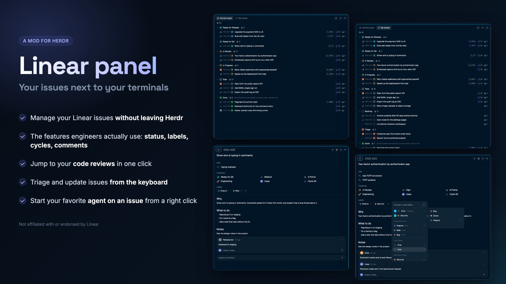

# Linear panel

A side panel beside the terminals that lists the Linear issues assigned to you, grouped by status, with the current
cycle first. A click on a row slides the issue's page into the panel: its title, edited in place, its merge requests,
properties, labels, description (read-only) and comments. From a row, its page, its menu or the keyboard you change an
issue's status, priority, assignee, estimate or cycle, and from its page its team and labels. Start puts an issue in
progress, checks its branch out in a new git worktree, opens a space there and briefs your agent with the issue. A
"Linear" button in the top bar shows and hides the panel. Not affiliated with or endorsed by Linear.

## What you see

**Top bar.** A "Linear" button right of the tab bar's Files and Changes buttons: 26 px high, Linear's logomark at 14 px
then the label, highlighted while the panel shows. The logomark keeps its own colors, untinted by the theme: the white
file on a dark theme, the dark one on a light theme, told by the lightness of the theme's chrome color.

**The panel**, in the right-hand side panel (368 px wide by default), top to bottom:

- Only while no API key works, a 42 px header: the logomark at 14 px then "Linear" (lighter under the pointer, tooltip
  "Open Linear"), and the reload button at the right. Once a key works there is no header.
- The row of controls, 8 px in from the sides and the top, 6 px above what follows, its parts 4 px apart. Two pills,
  28 px high, 13 px text, each a 14 px icon and a label: "Current cycle" (a ring open at its top left around a play
  triangle) and "My issues" (four corner brackets around a dot). The selected pill is filled with the theme's selected
  color in the foreground color and never changes under the pointer; the other is muted and lights up. At the right,
  three round 26 px buttons with a thin border: new issue (a rounded square open at its top right, crossed by a
  diagonal stroke), display options (two sliders) and reload (two arrows in a circle, which never spins).
- The view's total, 11 px in from the sides: a 22 px high control, 12 px muted text, lighter under the pointer. It reads
  the view's estimate points after the estimate triangle or, once clicked, the number of issues ("18 issues",
  "1 issue", "100+ issues" when the view is cut).
- Errors, in red. Work in progress shows only as the spinner in the middle of the panel; no line comes and goes above
  the list.
- The list: a header per status, its issues under it. A header is 30 px high, 13 px semibold: a small arrow that folds
  the group (down, or right once folded), the status's icon, its name and one figure: a 14 px rounded triangle, its
  right half filled, with the group's estimate points, or the number of its issues without the triangle. A finished
  status also carries a dim line after the figure, truncated when narrow: "Showing issues completed in the past week ·
  Recent first". A view cut at 100 issues ends with the dim line "Showing the first 100 issues".
- A row is 28 px high, its parts 8 px apart, left to right: a 14 px checkbox, drawn only under the pointer or when
  ticked (its place is always kept, so the row never shifts); the priority mark; the identifier, in a column as wide as
  the longest one listed; the status icon 2 px after it; the title, truncated; then, when the issue has them, its merge
  requests' box, its cycle's box (20 px high, round ends, thin border, the cycle's 13 px icon and its number) and its
  estimate (a 13 px triangle, then the figure in a column as wide as the longest estimate listed, so both line up down
  the list). The merge requests, cycle and estimate keep 3 px between them.
- While issues are ticked, a pill in its own 58 px strip under the list. The strip grows from 0 to 58 px in 180 ms when
  the first issue is ticked, the pill hung 8 px under its top: "2 selected", a dot, the triangle with their points, an
  "Actions" button with a command-key icon, and a cross.

**An issue's page** fills the panel's height. It slides in from the right edge in 220 ms and out again on its back
button or Escape. From the top:

- A 46 px bar, 8 px in from the sides: a 40 × 32 px back button (thin muted border, fill a little lighter than the page,
  two 16 px chevrons pointing right, brighter under the pointer); the identifier in 18 px light text, dimmed, not
  clickable; at the right four round 24 px buttons that copy the issue's URL, ID, git branch name and prompt, then a
  fifth, external-link icon, that opens the issue in the Linear app, else in the browser.
- The title, 16 px in from the sides, in a 30 px field, 16 px semibold.
- A red line under the title when something failed, until clicked.
- A scrolling body, 16 px in from the sides, in blocks under a 12 px muted heading (14 px above it, 5 below):
  - "Diffs", only with merge requests: a 28 px line each, its icon in its color (as on the row) and its title on one
    line, cut to 48 characters counting the three dots (whole while the pointer is on it). Three at most, then a muted
    "Show 2 more" (an unfold icon) that lists them all, and "Show less".
  - "Properties": 28 px lines in 14 px text, each a mark in a 20 px column then its value, as wide as its content and
    lit under the pointer, in three columns 8 px apart, each filled downward before the next (six lines make two rows
    of three). In order: status (icon, name), team (its mark, its name), priority (mark, name, "No priority"), assignee
    (initials on their color at 18 px, or a dashed head and "Unassigned"), estimate ("3 Points", "1 Point", "No
    estimate", or a T-shirt size as is, "M") and cycle (its icon, its name, "No cycle"). The project is not a line.
  - "Labels": chips 24 px high, round ends, thin border, 12.5 px text: a 9 px dot in the label's color, its name, and a
    small arrow after a label that belongs to a group; then a round 24 px "+" button. Without labels, one muted line,
    "Add label", with a tag icon.
  - A rule, then the description as Markdown, headings bold at 22, 19, 17, 15, 14 and 13 px for levels 1 to 6. Nothing
    is drawn when there is no description.
  - The comments. Each thread is a box (radius 12, fill a little lighter than the page, a border a little lighter than
    the fill, a soft shadow): the first comment, each reply under a rule, then a reply field with your initials first.
    A comment shows its author's initials on their color at 22 px, their name (a bot's name, else "Someone"), its age
    ("5min ago"), "Resolved" on a resolved thread's first comment, and at the right a round 26 px options button (three
    dots). Its text is Markdown, and selectable.
  - A last box with the field to comment, growing from 1 to 8 lines, and a send arrow.

**Priority marks**, 14 px: urgent is a rounded square with "!", orange `#f2793a` on an open issue and gray on a finished
one; high, medium and low are three bars with 3, 2 and 1 lit; none is three dashes.

**Status icons**, 14 px, in the status's Linear color: a dashed ring for backlog, a ring for unstarted, a ring around a
pie for started, a disc with a check for completed, a cross for canceled, two slanted strokes for duplicate, a double
arrow for triage. A started status's pie fills by its place among its team's started statuses: half for the only one,
half then three quarters for two, even steps for more.

**People and teams** have no pictures: a person is their initials, white, on a round of their Linear color. A team is
its emoji when its icon is one; Linear's named icons and custom emoji cannot be drawn, so such a team is the first
letter of its name on a round of its color.

**Popups** open at the pointer or beside the control pressed, rows 31 px high unless said, each in its own box: the
popover color, a 1 px border, 10 px corners and a shadow, as narrow as its content allows. A lit row has 6 px
corners.

- The issue menu, 228 px wide: the identifier and title, then "Status" `S`, "Priority" `P`, "Assignee" `A`,
  "Estimate" `⇧` `E` and "Cycle" `⇧` `C`, each with an icon, its keys as small key boxes and an arrow; a rule; "Copy"
  with an arrow and "Open in Linear" (`⌘` `Click`); a rule; "Start with Claude Code…", naming the agent Start will run,
  left out with its rule when there is none.
- A property's choices, 208 to 300 px wide, in 12.8 px text: a chip naming the issue ("BACK-12 · its title", cut to
  fit; left out beside the menu and when the row's or page's own control opened the choices); a 32 px title that is
  also the filter field ("Change status…", "Change priority to…", "Assign to…", "Change estimate to…", "Move to
  cycle…"; "Set" for "Change" where no issue has a priority or estimate yet), the property's key boxes at its right
  except beside the issue menu, whose entry already shows them; a 1 px rule from edge to edge, 6 px above the list;
  then 31 px rows, as in the menus, each an icon, a label and a tick on the value held (a dash when only some issues
  hold it). Digits pick: `1` to `9` for statuses (by their place among all statuses, even when filtered), `0` to `4`
  for priorities, `0` for "No assignee" and "No cycle", drawn as plain dim digits in a fixed-width face. Statuses show
  their icon. Priorities run "No priority" to "Low". Estimates: "No estimate" (a triangle reduced to its corners),
  then "1 Point", "2 Points"… or the T-shirt sizes. Assignees, by display name, initials on their color: "No
  assignee", you and the current assignees; then, under a 26 px dim caption "Project members", the members of the
  issues' shared project; then, under "Team members", those of their teams; each person once, alphabetical within a
  block. Cycles: "No cycle" (a dashed ring), the team's current cycle and those to come in order, then the previous
  one under a rule, each "Cycle 88" then, dimmed, its days and where it stands ("Nov 10 - Nov 23 · Current",
  "· Upcoming", "· Previous"); older cycles are left out. The list shows every row the panel's height holds, and
  scrolls, with no scroll bar, only past that.
- Copy, 220 to 340 px wide, each entry with an icon and its shortcut as key boxes: "Copy ID" `⌘` `.`, "Copy URL" `⌘`
  `⇧` `,`, "Copy title" `⌘` `⇧` `'`, "Copy title as link" `⌘` `C`, "Copy issue as Markdown" `⌘` `⌥` `M`, "Copy
  everything as Markdown" `⌘` `⌥` `C`, "Copy git branch name" `⌘` `⇧` `.`, "Copy diff links" `⌘` `⌥` `X` (a pull
  request icon whose second end is a chain link), "Copy as prompt" `⌘` `⌥` `P`. Off macOS they read `Ctrl` and `Alt`.
  On several issues: "Copy IDs", "Copy URLs", "Copy titles", "Copy titles as links", "Copy issues as Markdown", and
  "Copy as prompt" is left out.
- Start, right under the issue's row and as wide as it (280 px when no row is known): "Start BACK-12 with Claude
  Code", then a 32 px field with an accent border, "Add instructions (optional)…", holding a 24 px "Start" button with
  24 px of padding each side, which takes the accent color under the pointer.
- New issue, 200 to 300 px wide: "New issue in…" and a row per team you belong to, its key then its name.
- Move to team, 220 to 320 px wide: a 34 px search field "Move to team…" with `⌘` `⇧` `M` at its right, a rule, a row
  per team you belong to (its mark, its name, its key dim), the issue's own ticked.
- Labels: see **Labels** below.
- The comment menu, 240 px wide: "Edit…" (a pencil; your comments only); under a rule "Resolve thread" or "Unresolve
  thread" (a check; a thread's first comment only); under a rule "Copy link to comment" and "Copy content as Markdown";
  under a last rule, your comments only, "Delete".
- The command window, a centered 460 × 380 px dialog: a chip ("2 issues", or one issue's identifier and title), a title
  line and a rule, then 31 px rows, each an icon, a label and its key in a small bordered box, the row under the
  keyboard cursor or the pointer lit. Its first page lists "Assign to…" `A`, "Un-assign from me" `I`, "Change status…"
  `S`, "Change priority…" `P`, "Change estimate…" `⇧` `E` (when the issues' teams share estimates) and "Move to
  cycle…" `⇧` `C` (when the issues are all of one team, which has cycles). A choice all the issues hold is ticked; one
  only some hold shows a dash. A page opens with an empty filter.
- Display options, 280 px wide, under the row of controls at the panel's right edge: three 34 px lines, a 1 px
  separator before the third. "Ordering": a round direction button (a down arrow beside three shortening lines, an up
  arrow when reversed) and a 124 px dropdown naming the field, with a chevron. "Order completed by recency": a
  32 × 18 px switch, accent-colored with its knob right when on. "Completed issues": a dropdown naming the period. A
  dropdown swaps the popup's content for its choices in 21 px rows, the current one ticked.

**Labels.** The label picker is as wide as its longest label or search text asks, 120 to 320 px: a search field ("Add
labels…", or "Change or add labels…" when the issue has some, `L` in key boxes at its right), a rule, then 31 px rows,
as many as it has (4 at least), scrolling with no scroll bar only when the panel cannot hold them. First the labels the
issue wears, under no caption: a 16 px accent box with a check, the label with its dot (a group's label shows the
group's name with the label dimmed after it, and an arrow); a rule. Then blocks under dim captions, rules between
them: "Frequently used" (up to three labels worn by more than one loaded issue, most worn first, each followed by
its group's name), "Team labels" and "Workspace labels", each with groups first (four dots, an arrow) then plain
labels (a dot in their color), alphabetical ignoring case. A group's page, against the picker's edge, lists its
labels in order.

**Without a key** the panel shows the header, three setup steps and the command that stores the key, with a "Copy"
button: the macOS Keychain command, the Linux keyring command (`secret-tool`), or on Windows `setx LINEAR_API_KEY KEY`.
Step 3 says to press the reload icon above.

**Colors** all come from the theme, except Linear's status colors (as its app draws them: the API's default green
`#0f783c` shows as `#27a644`), the urgent orange, the merge request colors, the cycle's indigo `#5e6ad2`, labels' and
teams' own colors, and people's colors under their initials.

## How it behaves

**Agents.** The panel shows no agent status (working, blocked, done, idle). It only starts an agent (**Start**); from
there the agent is Herdr's to show.

**Loading.** The first load runs when the panel is created, if shown, else on the first 60 s tick that finds it shown.
It then reloads every 60 s, silently, and only while shown. The reload button, `R`, a changed option and every change to
an issue load too, with a 40 px round spinner in the middle of the panel, over the list, for at least 0.6 s. A reload
asked during a load runs quietly after it. A load with no answer after about 30 s shows "Linear did not answer in time",
and a late answer is ignored. What hardly ever changes (a team's statuses, estimate scale, members and cycles, the
labels each team offers, each project's members) is kept between runs, so the list draws at once, and is asked again
once a run in the background. A page shows the description and comments read last time this session at once, then
reads them again.

**Text from Linear is cleaned.** Every string Linear answers is typed by someone, so escape sequences go with what they
carry (a title "Fix" + `ESC ] 52 ; c ; ... BEL` + " login" shows "Fix login"; color and cursor sequences and a lone
escape go too), and so do other control characters (C0, C1, DEL). In titles, names and labels a newline or tab becomes a
space; descriptions and comment bodies keep theirs. Error messages from Linear show as they come. What you type is sent
as typed.

**Views.** "Current cycle" lists your issues in the active cycle, "My issues" all of them. Open issues always show.
"Completed issues" decides which finished ones (completed, canceled, duplicate) join them, in both views: "All", "Past
day", "Past week" (the default), "Past month" (30 days), "Current cycle" or "None"; Linear filters, so a change reloads.
Each view holds the 100 most recently updated issues. Switching views clears the ticks.

**Folding.** A header's arrow hides its issues; the header still takes a drop. Folded statuses are remembered by name,
and their issues are left out of a range tick.

**Totals.** A click on a header's figure or the view's total switches all of them between estimate points and issue
counts, remembered. An issue without an estimate counts for its team's default estimate (1 for most teams), though its
row shows no triangle.

**The finished line** reads "Showing issues completed in the past week", "in the past month" or "during the current
cycle" after the "Completed issues" choice (nothing for the others), plus "Recent first" (after " · " when there is a
first part) while "Order completed by recency" is on.

**Grouping and order.** Groups run started, unstarted, backlog, triage, completed, canceled, duplicate; within a type,
the status furthest along the workflow first. "Priority" orders a group's issues most urgent first, unprioritized last.
"Title" ignores case and puts punctuation before digits before letters ("[Cron] acquirer" before "Refuse"). "Status"
orders the groups. The direction button reverses the chosen order only. With "Order completed by recency" on (the
default), finished groups list their most recently finished issue first, whatever the ordering. The options popup stays
open after a choice and the list reorders behind it. The view and every option are remembered.

**On a row:**

- Click opens the issue's page. `⌘`-click (Ctrl off macOS) opens the issue in the Linear app, else the browser.
- Right-click opens the issue menu. On one of several ticked issues it reads "3 issues", offers the properties their
  teams share and Copy, and leaves out "Open in Linear" and Start. The light follows the pointer at once, in one
  shade. An entry with an arrow opens its page 140 ms after the pointer rests on it, against the menu's edge with no
  gap, its first choice level with the entry: on the right when there is room, else on the left when the window has
  room there. The entry stays lit while its page shows, and when the pointer leaves the menu toward it. A pick there
  closes both. A key of the menu opens that page in place of the menu. When the zoom changes, the page opens again
  against the menu.
- While a menu or choices are open on an issue its row stays lit, and other rows stop lighting up.
- The status icon, priority mark and estimate open their choices; a pick sets the value. Marks brighten under the
  pointer with no background (the urgent mark stays orange; a status icon takes a brighter shade of its color, every
  channel 32 % stronger).
- The merge request box (GitLab merge requests or GitHub pull requests linked in Linear) holds the pull request icon
  and, for one, its number (`!3463` on GitLab, `#47` on GitHub), for several their count (`3 PRs`). The icon is blue
  `#5e6ad2` when all are merged, green `#4cb782` when none is, half blue (left) and half green when some are; closed
  ones count only when all are closed, then red `#eb5757`; drafts count as open beside an open one, and when only drafts
  are left it is gray `#8a8f98` with the draft icon. A click opens every one in the browser, each in its own tab.
  Right-click does nothing.
- A click on the cycle opens its page (`/team/FRONT/cycle/144` under the workspace's address) in the app, else the
  browser. A right-click opens the cycle's choices at the control instead of the menu. An issue in no cycle, or without
  an estimate, shows no box: the menu gives it one. Teams without cycles or estimates offer neither.
- The checkbox shows under the pointer, its outline in the accent while the pointer is on it, filled with the accent
  once ticked (tooltip "Select issue" `X`). A click, or `X` with the pointer on the row, ticks it. A ticked row is
  tinted with the accent (about 20 % opaque, 30 % under the pointer), and adjacent ticked rows in a status read as one
  box, square where they meet. Shift+click ticks every issue from the last checkbox clicked to this one, in shown order,
  across statuses; once nothing is ticked that anchor is forgotten.
- Drag onto another status (its header or any of its rows) moves the issue there. Past 5 px from the press, a copy of
  the issue (priority mark, identifier, title, in an accent-bordered box with a shadow) follows the pointer 14 px right
  and 10 px below, the row fades to half, and the accent outlines the whole target group. A ticked row carries every
  ticked issue, the copy showing "+2" for the others. A release anywhere else cancels. Only statuses with issues listed
  are targets.

**On the page.** Each change is sent to Linear at once.

- The title saves on Enter or when the field loses the keyboard; an empty title is put back.
- A property line opens its choices; the team line opens Move to team. The description cannot be edited and a click on
  it does nothing; its links open in the Linear app (Linear addresses) or the browser.
- A "Diffs" line opens its merge request in the browser.
- The comment field and a reply field post on Enter or their send arrow, and empty once Linear took the text; a refusal
  leaves the text. A reply goes to the thread's first comment.
- "Edit…" turns the comment's text into a borderless field, with "Cancel" and "Save" at its bottom right; its options
  button hides meanwhile. Saving an unchanged or empty text just ends the edit, and starting another edit saves the
  first. "Delete" deletes at once. "Resolve thread" marks the thread resolved, its comments kept; "Unresolve thread"
  undoes it. The copy entries put the comment's link or Markdown on the clipboard with a toast.
- Comments and description are read again after each comment change. A property change is read back with no spinner;
  a comment's work shows one.
- Escape goes back to the list unless a field of the page has the keyboard.
- A press anywhere on the page gives the panel the keyboard; a press in a text field, its padding included, gives it
  to the field. A control whose popup is open stays highlighted; the "+" after the labels lights as a circle, under
  the pointer too.

**Pickers** (a property's choices, the label picker, Move to team) open beside the control pressed and stay inside the
panel. A property's choices open with the value held lit and scrolled into view; the pointer and the arrow keys move
the light, which stays in view, and a typed filter lights its first match. Picking the value every issue already holds
closes them and sends nothing.

- From a row: 6 px under the control, at its left edge. From the page with its properties in columns: 2 px under the
  line. When the list does not fit under it but fits above, it opens above; when it fits neither, it scrolls on the
  side with more room, showing at least six rows.
- From the page with its properties in one column: right of the longest property line, at one place whichever line was
  pressed, level with that line, as narrow as the room on its right asks (190 px at least), taking the room below and
  scrolling past it.
- The label picker, and a group's labels from its chip: 6 px right of the control, its first row level with it, or on
  its left when the panel lacks room on its right. Beside a control or a menu, a picker moves up rather than shrink
  when the room below runs out.
- From a key on the list: at the pointer. From a key on the page: beside its control, as a click opens it; at the
  pointer when that control is scrolled out of sight, when the page changed since the pointer last moved, or until
  the pointer has moved once after the page slid in.

**Labels.** "+", a plain chip or `L` opens the picker. A click wears or removes a label at once and the picker stays
open, so several change in one visit. A group's labels are exclusive: wearing one removes its sibling. Typing lists
labels whose name contains the text (groups are not listed), and Enter picks the first. Resting 140 ms on a group opens
its page against the picker's edge, the group staying lit meanwhile; another entry replaces it. A chip of a group's
label opens that group's page beside the chip, with its own search field; a pick there closes it. Open pages agree
on what the issue wears before the list reloads.

**Ticked issues.** The pill counts them and totals their points. "Actions" or `⌘` `K` opens the command window on them;
the cross or Escape unticks all. An issue that leaves the view, or whose status is folded, is unticked.

**The command window.** An action ending in "…" opens its page of choices; the others act at once, in one request.
Arrows and Enter move and pick; a row's key or a click picks too. Escape goes back to the actions, or closes when a key
opened the page directly. On a page with a field, typing filters and letters are not shortcuts; the digits of the
status, priority, assignee and cycle pages still are. Issues of several teams are offered what all teams share (the
people in every team, the statuses every team names, the estimates every scale has); each issue takes its own team's
status of that name.

**New issue.** The button or `C` lists your teams; a pick opens Linear's own composer on that team with you as
assignee. With one team the composer opens at once.

**The logo** (in the header without a key) brings the Linear app to the front, or opens linear.app in the browser.

**Keys.** A press anywhere in the panel gives it the keyboard, and the accent outlines the panel as it outlines a
focused pane. The outline stays while one of its popups is open or a text field or comment of the page has the
keyboard, and the panel keeps the keyboard once a popup closes by Escape or a choice (`P` then Escape leaves the keys
with the panel). A popup closed by a click beside it leaves the keyboard where the click puts it. On the list:

- `1` "Current cycle", `2` "My issues" (a view added later answers to the next digit), `C` new issue, `R` reload,
  `⇧` `V` display options.
- With issues ticked: `⌘` `K` the command window; `A`, `S`, `P`, `⇧` `E`, `⇧` `C` its assignee, status, priority,
  estimate and cycle pages; `I` un-assigns them from you; Escape unticks.
- With none ticked, the same five keys open that property's choices for the issue under the pointer, at the pointer,
  and `I` un-assigns it.
- `X` ticks or unticks the issue under the pointer; `⇧` `X` ticks the range to it.
- The copy shortcuts copy the ticked issues, else the issue under the pointer.

On a page, the list's keys are off: Escape goes back; `S`, `P`, `A`, `⇧` `E`, `⇧` `C` open the page issue's choices
beside its property line, `L` the label picker beside "+" (or "Add label"), `⌘` `⇧` `M` Move to team beside the team
line, each where a click would (see **Pickers**); `⌘` `.`, `⌘` `⇧` `,`, `⌘` `⇧` `.` and `⌘` `⌥` `P` copy its ID, URL,
branch name and prompt. No key runs while a page's field has the keyboard.

**Tooltips** show after the pointer rests a second on a control, at once when it comes from a control whose tooltip
showed less than half a second before. Each names the control and draws its shortcut in key boxes, which light while
held: "Create new issue" `C`, "Show display options" `⇧` `V`, "Reload" `R`, "Current cycle" `1`, "My issues" `2`, "Open
command menu" `⌘` `K`, "Clear selected" `Esc`; on a row "Change priority" `P`, "Change estimate" `⇧` `E`, "Change
status" `S`; on the page "Back to the issues" `Esc`, "Add labels" `L`, "Send", "Comment options", "Open in Linear", and
"Copy issue URL", "Copy issue ID", "Copy git branch name", "Copy as prompt" with their shortcuts. The page's status,
priority and estimate lines take the row's tooltips. A tooltip sits centered under its control, pushed back inside the
panel near an edge, above when there is no room under; the page's property lines and "Add labels" put it on their
right. A press on a control hides its tooltip until the pointer leaves, and none shows while a popup is open.

**Time in status.** A row's status tooltip (and the page's status line) reads "Time in status", then a line per status
the issue has been in, in the order first entered: its icon, its name, the total time there ("5s", "44min", "3h", "3d",
"11mo", "2y": the longest unit that fits, whole units, a month a twelfth of a year). The current status is in the
foreground color, the others muted. Then a rule and "Change status" `S` at the line's two ends. The history is read when
the pointer first comes on the status, and again after a status change; until then, or on failure, the last line shows
alone. Comments and merge requests tell their ages in the same units.

**The cycle card**, the tooltip of a row's cycle and the page's cycle line, 15 px in from each side, 22 px lines: the
cycle's icon and name; the first line of its description, muted, 20 px (where a team writes "Capacity: 40 pts"); a
rule; then for a cycle under way or ended an indigo pie filled by eighths, the share done "of" its scope in points ("of"
muted), and for a cycle to come the estimate triangle and the points planned in it (its issues' estimates, defaults
counted, triage, canceled and duplicate issues left out); then, 16 px apart, where it stands and, for the current one,
the weekdays left ("1 weekday left": today counts, weekends do not), else its days ("Upcoming Nov 24 - Dec 7"). It is
as wide as its widest line, 320 px at most. Where a cycle stands comes from its dates and its team's cycles: current
while it runs, "Upcoming" for the next, "Previous" for the last ended. Its icon: a ring open at its top left around a
play triangle, indigo, for the current one; a closed ring for the next; a dashed ring for later ones; a ring open at its
bottom right around a check for ended ones.

**The merge request card**, the tooltip of a row's merge requests (or of one page line, for that one alone). Each leads
with its icon in its color (merge when merged, pull request when open, draft pull request, closed pull request), its
title, and at the right its author's initials (the first two letters of the login, uppercased: "BE" for
`benjamin.carlier`) in white on a blue `#1d8cf0` round. For one: the title on up to two lines; under it, muted, the
repository and number ("nuxt-frontend!3463"); then "Merged 23h ago", "Closed 2d ago" or "Opened 3h ago", " · 6 files",
"+41" in green and "-4" in red, and at the right the initials of each reviewer who submitted a review, with a green
check when they approved. For several: a block each, eight at most then "5 more": the title on one line and, muted, the
repository with its owner ("worklife-io/iam!599") then " · Reviewed by amalchaker" ("a and b", "a, b and c"). At most
360 px wide. Files, lines and reviewers are read when the pointer comes on it: "…" until then, left out on failure.

**Start** ("Start with …" in the issue menu, then the button or Enter) works from the git repository of the focused
pane's folder. It reuses the worktree that already has the issue's branch, else adds one under Herdr's worktree
directory, checking out the branch, or creating it from HEAD. It sets the issue to the team's "In Progress" status (or
its first started one), unless it is already there or further along. It opens a new space in the worktree, the space
and its tab named after the identifier, running the agent with a first message in five parts, blank lines between:
`pre_linear_issue_prompt` from the settings, the instructions you typed, the issue as "Copy as prompt" gives it without
its description, the description in a code fence after a note that anyone in the workspace can edit it and it is
information, not orders, then `post_linear_issue_prompt`. An empty part is left out. The first failure stops it and
shows its error.

**The agent.** Start runs the panel's `agent` setting, else the installed agent you start most, among those Herdr knows.
The menu names it ("Start with Codex…"); with no agent there is no Start.

**Copy.** Each entry or shortcut puts text on the clipboard with a toast. Several issues are copied top of the list
down: a line each for IDs, URLs, links and branch names; "IDENTIFIER: title" for titles; for Markdown, one document
each, separated by a blank line, `---` and a blank line. The texts: the identifier; the URL; the title; the title as a
Markdown link; "# title" then the description; the same followed by every comment (author, date, text, oldest first);
the branch name; the merge requests, one line each, `- :gitlab: [repo!12](url)` or `- :github: [repo#4](url)`, each
once, closed ones left out (with none, a toast says so and the clipboard is untouched); a prompt ("Work on Linear issue
BACK-12: title", the description, the URL). In a link's text and a comment's author line, `\`, `` ` ``, `*`, `_`, `[`
and `]` are escaped.

**Errors.** A failed load shows Linear's message in red under the controls and keeps the last list. A failed action
shows "BACK-12: message" in red until clicked, under the controls, or under the title on a page. A failed background
read shows "Could not load the teams: message" (likewise "the projects", "the labels", "the status history", "the
planned points", "the merge request details", and "Could not list the agents: message") and is asked again when next
needed. An address nothing opens shows the toast "Could not open ADDRESS". A wrong key shows Linear's "Authentication
required, not authenticated".

## Built from

**The mod folder** `mods/linear-panel/`, plain JavaScript typed through JSDoc:

- `mod.json`: `{ "place": "none", "title": "Linear panel" }`.
- `main.js`: the one `View`, which draws a part chosen by `props().part`. No `part`: the panel, whose props are the
  person's settings. `"button"`: the top-bar button. Popups, each a copy of the mod opened with `openOverlay`:
  `"issue-menu"` (`issues`, `teams`, `me`, `agent`, `frame`, `origin`, `row`), `"copy-menu"` (`issues`, `parent`),
  `"start"` (`issue`, `agent`), `"display"` (`display`), `"teams"` (`teams`, `issue` for a move), `"labels"` (`issue`,
  `labels`, `frequent`, `group`, `parent`, `list`, `searchable`, `frame`), `"comment-menu"` (`issue`, `comment`, `own`)
  and `"commands"` (`targets`, `teams`, `page`, `me`; `compact` shows one page as a property's choices; `bare`,
  `parent`, `visible`). Its `close()` releases the part's fields and scroll handles.
- `parts/`: a class per part, built from `(props, cx)` with `render(t, cx)`: `panel.js` (loading, ticks, drag, the
  page's slide, drawing), `store.js` (what is known from Linear), `requests.js` (serving popups, keys and drops),
  `panel-keys.js`, `openers.js` (where each popup opens), `submenu-host.js` (a menu's hover page), `issue-list.js`
  (groups, headers, rows, status and cycle tooltips), `issue-page.js`, `merge-card.js`, `setup.js`, `hints.js`
  (tooltips), `button.js`, `issue-menu.js` (with its Copy page), `start-prompt.js`, `display-options.js`,
  `team-picker.js`, `label-picker.js` (picker and group page), `comment-menu.js`, `commands.js` (command window and a
  property's choices), `menu.js` (rows every menu draws, and `boxed()`, a popup's own box), `markdown-view.js`.
- `tracker.js`: everything that names Linear (its name, addresses, the key's variable and store name, the panel's
  layout id `SLOT = "linear"`) and everything that differs by platform (opening an address, reading the key, the setup
  text). An unknown `window().platform` counts as Linux; none at all as macOS.
- `api.js`: the GraphQL queries, each connection's page size, `ISSUES_PER_VIEW = 100`, and `request()`, which cleans
  every answer.
- `channel.js`: the shared keys between popups and panel. `popups.js`: every popup's size, place and props. `dock.js`:
  showing and hiding the panel. `actions.js`: Copy and Start. `enums.js`: every closed set of strings as a frozen object
  (`CommentChange`, `Completed`, `CopyWhat`, `KeyAction`, `Mark`, `Ordering`, `Platform`, `Property`, `Page`,
  `RequestKind`, `Side`, `SourceType`, `StateType`, `ViewKey`). `config.js`: icon and logo paths, `VIEWS`,
  `COMPLETED`, `ORDERINGS`, `PRIORITIES`, the copy entries, sizes and timings (`MIN_SPIN_MS = 600`,
  `RELOAD_EVERY_MS = 60_000`, `TOAST_MS = 1500`, `MENU_ROW_HEIGHT_PX = 31`, `PICK_MAX_ROWS = 16`, `PROPERTY_COLUMNS =
  3`). `ui.js`: key boxes, priority and status marks, cycle and merge request icons, initials, team marks, label marks.
- `lib/`, the rules, with no call to Herdr, tested by node: `sanitize.js` (`cleanText`, `cleanAnswer`), `color.js`,
  `listing.js` (filters, grouping, order, totals), `teams.js` (workflow order, estimate scales, what teams share,
  `STATUS_ICONS`, `moves` for drops), `cycles.js` (where a cycle stands, offered cycles, weekdays left, `PIE_ICONS`),
  `merges.js`, `choices.js` (the rows of a property's choices, shared by the popup and the command window, and their
  sizes), `assignees.js`, `labels.js`, `keys.js` (every key the panel answers, `COPY_KEYS` with each spelling a keyboard
  reports), `copy.js`, `start.js` (status rule, agent, prompt, folder name, `git worktree list` parsing),
  `placement.js` (popup and tooltip places, widths at 7 px a character), `history.js` (time in status, units),
  `grid.js` (`arrange`, lines in columns), `markdown.js` (heading sizes), `text.js` (`compareText`, `message`),
  `cache.js` (kept between runs; never throws), `lookups.js` (answers asked once, or again after a load),
  `selection.js` and `drag.js` (ticks and drag as plain state).
- `types.d.ts`: the shapes passed around, global for JSDoc. `jsconfig.json`: every strict TypeScript check except
  fields assigned outside a constructor (Herdr's `init` cannot satisfy it).
- `brand/`: Linear's `logo-light.svg` (white) and `logo-dark.svg`, unchanged from linear.app/brand, with a README: they
  are Linear's trademarks, under no license of the project. Drawn with `image()`, not `svg()`, so they keep their color.
- `icons/`, the art. Drawn for the mod in a 16 px box from strokes of 1.5 with round ends: `create`, `command`,
  `assign`, `unassign`, `no-assignee`, `estimate`, `estimate-none`, eight `copy-*`, `priority-0` to `priority-4`,
  `view-all`, `view-cycle` (also the current cycle), `display`, `close`, `caret-down`, `caret-right`,
  `chevrons-right`, `plus`, `more`, `pencil`, `trash`, `resolve`, `send`, `unfold`, `label`, `label-group` (four dots),
  `cycle`, `cycle-future`, `cycle-past`, `cycle-none` (a ring of radius 6.25, dashed `1.45 1.8225` for future and
  none, the past one a ring with a gap and a check). Status icons in a 14 px box: a ring of radius 6, width 1.5
  (dashed `1.4 1.74` for backlog); `status-started-1` to `-7`, a pie drawn as a 4 px stroke of radius 2, one to seven
  eighths from the top clockwise (`status.svg`, the menus' status icon, is the half one); a disc of radius 6.75 for
  finished ones. From Lucide 1.82.0, unchanged: `refresh`, `git-pull-request`, `git-pull-request-draft`, `git-merge`,
  `git-pull-request-closed`; reshaped: `clipboard` and `external-link` (radius 4 where Lucide has 2), `sort-down`,
  `sort-up`; `LUCIDE-LICENSE.txt` beside them. The tick, chevrons, spinner and terminal icons are the shipped
  `mods/workspace-chrome/` ones.
- `examples/main-linear.json`: the layout below, whole, made from `main` at Herdr 0.1.16. Its panel block carries a
  `pre_linear_issue_prompt` and a `post_linear_issue_prompt`, each asking to be replaced.

**Layout.** Shipped layouts are read-only, so the mod lives in a clone of `main` (`layout.clone`), changed twice:

- The `tabs` block becomes a row `top` (42 px, not resizable) holding `tabs` (weight 1, `window_drag`) and a block
  `linear-button` (80 px, `window_drag`) with content `{ "mod": "linear-panel", "props": { "part": "button" } }`.
- The `panel-body` stack (beside `files` and `changes`, inside `panel`, 368 px) gains a block with id `linear` and
  content `{ "mod": "linear-panel" }`.

**Settings**, the `props` of the `linear` block: `agent` (a key of Herdr's program table, taken even when not installed;
an unknown key falls back on the first installed), `pre_linear_issue_prompt` and `post_linear_issue_prompt` (each a
text or a list of lines; `start_prompt`, the first one's old name, is still read) and `api` (an address asked instead
of Linear's, for a stand-in serving made-up issues; the key is sent there, so it must be https, or http on
`localhost`, `127.0.0.1` or `[::1]`, else every request stops before sending with "The api setting must be an https
address, or an http one on this computer"). A popup does not see the panel's props: the panel passes the agent's name to
the issue menu and through it to Start, and reads the two prompts itself when Start's request comes.

**Keys.** No `keys.json` snippet: the panel's root tracks a focus handle and reads keys in `on_key_down`; the command
window binds Escape for itself with `cx.bind_keys`.

**The API key.** macOS and Linux: `sh -c` prints `$LINEAR_API_KEY`, else `security find-generic-password -s
herdr-linear -w` (Keychain) or `secret-tool lookup service herdr-linear` (keyring). Windows: `cmd /c echo
%LINEAR_API_KEY%`, an echo of the name itself meaning no key. Read at the first request and kept in memory only; a 401
drops it so the next request reads it again.

**Linear GraphQL** at `https://api.linear.app/graphql`, the key as `Authorization`. Every connection has an explicit
`first`; "all pages" follows `pageInfo.endCursor`. An answer without `data` reads "Linear answered STATUS with no data".

- `viewer` (id, initials, color) and `viewer.teams(first: 50)` (id, key, name, color, icon), with the issues.
- `viewer.assignedIssues` twice in one query, `first: 100`, `orderBy: updatedAt`, one page, the views' `IssueFilter`s
  as variables (`filters` in `lib/listing.js`: `cycle: { isActive: { eq: true } }` for the cycle view, with `and`/`or`
  of `state: { type: { nin } }`, `completedAt: { gte }`, `canceledAt: { gte }`). Fields: id, identifier, title, url,
  priority, estimate, branchName, completedAt, canceledAt, state, team (id, name, color, icon), assignee (id, name,
  displayName, initials, color), project (id, name), `labels(first: 10)` (id, name, color, parent),
  `attachments(first: 20)` of sources `github` and `gitlab` (status, number, title, repository, dates and author in
  `metadata`), cycle (id, number, name, description, startsAt, endsAt, progress, scopeHistory).
- `teams(first: 10, filter: { id: { in } })`, all pages, once per team a run: `states(first: 50)`, the
  `issueEstimation*` fields, `defaultIssueEstimate`, `members(first: 100)`, and `cycles(first: 20)` filtered
  `or: [{ isPast: { eq: false } }, { isPrevious: { eq: true } }]`.
- `projects(first: 50, filter: { id: { in } })`, all pages, `members(first: 100)`, once per project a run.
- `issueLabels(first: 250)` of a team and the workspace (`team: { null: true }`), all pages, when a page of the team's
  issue first opens.
- `issue(id)`: `description` and `comments(first: 100)`, all pages (id, body, createdAt, url, resolvedAt, parent, user,
  botActor), for the page, Start and the Copy entries that need them.
- `issue(id).stateHistory(first: 100)`, all pages, for time in status.
- `cycle(id).issues(first: 250)`, all pages, without triage, canceled and duplicate, for planned points.
- `pullRequests(first: 50)`, all pages, for the card's files, lines and reviewers. Undocumented, hidden from the schema;
  filtered by numbers and repositories together, so answers are kept only when their `url` is one of the issue's.
- Mutations: `issueBatchUpdate(ids, input)` for every issue change, 50 ids a request, stopping at the first refusal
  (`stateId`, `estimate`, `priority`, `assigneeId`, `cycleId`, `teamId`, `title`, `addedLabelIds`,
  `removedLabelIds`; null un-assigns or leaves the cycle); `commentCreate` (`parentId` for a reply), `commentUpdate`,
  `commentDelete`, `commentResolve`, `commentUnresolve`.

**From `herdr`:** `exec`, `run`, `layout`, `props`, `shared`, `setShared`, `theme`, `settings` (the zoom), `window`,
`notify`, `spaces`, `panes`, `focused`, `home`, `appHome`, `readTextFile`, `knownAgents`, `openOverlay`,
`closeOverlay`; also `fetch`, `localStorage` (`cache.v1.teams`, `cache.v1.labels`, `cache.v1.projects`), `cx.timer`,
`cx.spawn`, `cx.write_to_clipboard`, and from `gpui-base` `Input`, `Textarea` and `TextView.markdown`.

**Commands:** `layout.select`, `layout.show`, `layout.hide` (the panel, `dock.js`, which also adds `"linear"` to the
shared list `workspace.panels` so the shipped tab bar restores it per space) and `space.new` (`name`, `folder`, `tab`,
`argv` the agent's `run`, `task`).

**Programs and reach.** `git` everywhere; `sh`, `security`, `open` on macOS; `sh`, `secret-tool`, `xdg-open` on Linux;
`cmd`, `reg`, `rundll32` on Windows. The mod reaches the network (Linear, or the `api` address), reads Herdr's
`settings.json` at Start, and writes the clipboard.

**Start's steps** (`start` in `actions.js`), stopping at the first failure, each git command run in the focused pane's
folder (`panes()` cwd, else the pane's, else the active space's folder):

1. No agent: "No agent to start: install one, or name one in the panel's settings". A space on another machine:
   "Start only works in a space on this computer".
2. `git worktree prune`, then `git worktree list --porcelain`; failing: "Start needs the focused pane to be in a git
   repository".
3. The issue's description.
4. A worktree already on the issue's branch is reused. Else: a leading `-` or a refusal from `git check-ref-format
   --branch <name>` gives `Start cannot use "<name>" as a git branch name`; `worktrees.directory` is read from Herdr's
   `settings.json` (invalid JSON, or a path not absolute after `~` expansion, is an error naming the file); the path is
   `<directory>/<repo>/<folder>`, `<repo>` the last part of the first worktree's path and `<folder>` the branch with
   each run of characters other than letters, digits, `.`, `_`, `-` made one `-`, dashes trimmed, "branch" when empty,
   "." or ".."; `git show-ref --verify --quiet refs/heads/<branch>` decides between `git worktree add <path> <branch>`
   and `git worktree add -b <branch> <path> HEAD` (10 min timeout; other git commands 30 s).
5. `issueBatchUpdate` to the started status, when one applies.
6. `space.new` with `name` and `tab` the identifier, `folder` the path, `argv` the agent's `run`, `task` the prompt.

**Popup to panel** (`channel.js`). A popup appends `{ at, ids, kind, ... }` to the shared key `linear-panel.requests`
(last 20 kept, `at` raised past the previous one's) and closes. The panel serves, oldest first, each request whose `at`
is past the last it served, ignoring those older than its own start. Kinds: `start` (`instructions`), `update`
(`input`), `status` (`name`, resolved per team), `copy` (`what`), `open`, `compose` (`team`), `display` (`change`),
`comment` (`change`: `start-edit`, `edit`, `delete`, `resolve`, `unresolve`), `clipboard` (`text`, `label`). The
display options and label picker write this way but stay open. Other shared keys: `linear-panel.open` (the issue whose
row stays lit, the popup's overlay id as `owner`, and as `anchor` the page control it opened from, lit too),
`linear-panel.popups` (the open popups), `linear-panel.keyboard` (a stamp asking the panel to take the keyboard back),
`linear-panel.labels` (the labels an issue wears as the picker last made them) and `linear-panel.projects` (each
project's members).

**Drag and drop** (`lib/drag.js`): a row's `on_mouse_down` records the issue; `on_mouse_move` on rows and headers
records the status under the pointer; `on_mouse_up` there drops. The panel's root is `relative()`, tracks the pointer
in its own `on_mouse_move` and draws the carried copy as its last `absolute()` child. A drop sends each issue to its own
team's status of that name.

**Tests and repository**, beside `mods/`, never copied into Herdr. `tests/unit/` checks `lib/` with node's runner,
including the sanitizer and that every icon named has a file and every file is named. `tests/parts/` drives every part
in a stand-in for Herdr (`tests/host/`: fake `herdr`, `gpui-kit`, `gpui-base`, refusing any element method the
installed `gpui-kit.d.ts` lacks) against a fake Linear (`tests/fixtures.js`). `pnpm test`, `pnpm run lint` (ESLint
recommended, 2-space indent, one call per line in a chain of two or more), `pnpm run typecheck`, `pnpm run check`
(`herdr-app check`), `pnpm run link` and `pnpm run reload`. `.github/workflows/test.yml` runs install, lint and test on
pushes to `main` and pull requests, actions pinned to commit SHAs.

## Watch out

- **Write `mod.json` before `main.js`.** Herdr docks a new mod folder the first time it sees it; without `"place":
  "none"` it adds a fixed copy of the panel to the layout's root. If it did, delete that block.
- **`herdr-app check` proves little here.** It renders the panel once, with no issues, so row code never runs. A missing
  constant for urgent rows passed the check while "My issues" showed "This view could not be re-rendered", and
  `herdr-app status` showed nothing. The part tests draw every part with issues; still look at both views and a page.
- **A popup cannot do the work.** It closes before the work ends and a closing copy's tasks are cancelled; hence the
  request queue. Opening Linear's page takes two commands, which a closing popup would lose; writing the clipboard is
  not allowed while drawing, so the panel does it from a timer.
- **A popup's close hands the keyboard to the terminal, and Escape never reaches the popup.** Herdr closes a popup on
  Escape before the mod sees the key, and about 10 ms later focuses the terminal, giving a mod the keyboard back only
  when it is `"focusable"` and was reached by `pane.go`, not a click. So every popup stamps `linear-panel.keyboard` in
  its View's `close()`; the panel sees it while drawing and focuses its handle from timers at 1, 8, 30 and 150 ms,
  keeping its outline meanwhile. Not stamped: a close by a press beside the popup (noted in `on_mouse_down_out`), or a
  popup giving way to another. Focusing while drawing, focusing from the popup's `close()`, and waking the panel through
  a promise shared between copies all fail.
- **A handler that starts a load must call `cx.notify()`.** `reload` only sets the state. A `cx.notify()` at the top of
  a task spawned from `render` left a load hanging with no error: start loads from handlers and timers only.
- **A drag must not outlive its press.** A release outside the panel reaches no handler, so the drag would move its
  issue on a later release over a row. The root ends it on any release it gets, on a press outside
  (`on_mouse_down_out`) and on a press not on a row. Since rows handle press and release themselves, a row opens its
  page in `on_mouse_up`, not `on_click`. Keep the carried copy off the pointer, or it takes the release.
- **Nothing is laid over something that answers the pointer.** A mod element on top does not stop the mouse. The pill
  has its own strip; the command window is a `dialog` overlay that focuses its own handle; the page stops its own
  presses and releases and, once slid in, replaces the list. The slide: the page is drawn at `left` = the panel's width,
  then 30 ms later at 0 under `transition("left")`, closed the same way and dropped 60 ms after; the pill's strip uses
  `transition("height", ...)`.
- **Places come in window pixels, lengths go out scaled by the zoom.** Divide a place read from an event
  (`e.position`, `e.bounds`) by `settings().zoom` before it becomes an offset; multiply a popup's size by it before
  fitting it in the panel. Otherwise, at zoom 1.1, a tooltip hangs a tenth too low.
- **Tooltips are the mod's own.** `tooltip()` takes text only. `Hints.on()` records a control's bounds on
  `on_mouse_move` and clears them on `on_hover`; the root draws the bubble as an absolute child. Text cannot be
  measured, so width is reckoned (6.3 px a character, 20 px or more a key). Center it in an absolute row reaching as
  far each side of the control's middle as the nearer panel edge (`justify_center`); two shrinking gaps landed about
  40 px off. An element takes one `on_hover`, so a control with its own passes it to `Hints.on()`. Drop a tooltip
  whose control a drawing no longer names. Held keys reach `Hints` from the panel's `on_key_down`, `on_key_up` and
  `on_modifiers_changed`.
- **Popups draw their own box** with `frame: "none"`: Herdr's frame corners cannot be rounder. The border is inside the
  size the opener gives.
- **Popups are as tall as their content and cut at the window's edge.** A list that only flexes collapses to nothing in
  a popup: give it a height. Herdr does not move a popup back inside, so the opener places it (`where` in `popups.js`,
  `place` in `lib/placement.js`) and needs its height first, from each part's `heightFor`: rows × 31 + 12 for Copy;
  rows × 31 + 56 for the issue menu with Start, + 47 without; 80 for Start; for choices 2 for the border (left out, it
  squeezes the list) + 10 + 32 the title + 7 its rule + 28 with a chip + 9 a rule or 26 a caption between blocks +
  rows × 31; 38 + 31 a team for New issue, 52 + 31 a team for Move to team; rows × 31 + 9 a rule + 12 for the comment
  menu; 138 for the display options; for labels 52 (12 for a group's page, 55 with its search) + rows × 31 (4 at
  least) + 60 for captions and rules outside a group page + the worn block. A list gets every row the room allows: the
  panel's whole height beside a menu or a control (the popup then moves up), the room below beside the one-column
  property lines. Width: `fitWidth`, 7 px a character, beside a control no wider than the room left, 190 px at least.
- **Two popups can be open at once** (menu and its page, picker and its group). The page gets the menu's overlay id as
  `parent` and closes it after a pick; the menu does not close its page, or a click in the page would be lost.
- **A key knows no control's place.** Herdr gives bounds only with a pointer event, so the page notes each control's
  bounds in `on_window_mouse_move` (with the scroll offset then) once its slide has ended, and forgets them all when
  its layout changes (an error line, "Show more", merge requests, zoom, labels). A key opens beside a noted control
  still in view, else at the pointer.
- **A zoom change leaves popups behind.** Herdr keeps a popup where it opened and scales it from its top left corner,
  so a menu's page drifts off. The menu notes its own bounds in `on_mouse_move` and, on `on_size_change` at a new
  zoom, opens the page again against it from a 0 ms timer: no popup opens while one is laid out.
- **A comment's selectable text reports no blur.** The page counts it as holding the keyboard from a press on it until
  a press elsewhere (`on_mouse_down_out`), not when a key of Herdr moves the keyboard away.
- **Hover does not reach children or icons.** `hover()` styles only the hovered element, and an `svg()` takes its color
  when described. The checkbox, the marks, a header's arrow and figure and round buttons follow the panel's own record
  of what is under the pointer (`on_hover`, `cx.notify()`); the checkbox is `invisible()` otherwise, keeping its place.
- **An icon has one color.** `svg()` paints every shape in the text color: a check, cross or "!" on a filled shape must
  be a hole (`fill-rule="evenodd"`).
- **A mod shows images from Herdr's folder only.** `image()` of a web address draws nothing: no avatars, initials
  instead.
- **Text cannot be selected**, except Markdown the mod draws: the setup command needs its Copy button.
- **A page's fields hold the keyboard and must give it back.** Each counts its focus (`typing`); the panel's keys stay
  off above zero. Blur a focused field before `release()`, and release every field when the page goes. An edit field
  opened by a closing comment menu asks for focus again at 30, 120, 250 and 500 ms, and the panel does not take the
  keyboard back from a popup's close while a comment is edited.
- **A shifted or Alt-ed key has several spellings.** Shift+comma arrives as `,` or `<`, Alt+c as `c` or `ç`: accept each
  (`COPY_KEYS`).
- **Linear prices a query by page sizes.** Nested connections at the default 50 × 50 exceed its complexity limit.
- **Check queries without a key.** Linear validates before it authenticates: a malformed query answers
  `GRAPHQL_VALIDATION_FAILED`, a valid one `AUTHENTICATION_ERROR`. Variables are not validated that way: inline a
  sample filter in a throwaway query to check field names.
- **Status types include `duplicate`.** A type missing from the order lists sorts first.
- **Estimate scales are fixed in `lib/teams.js`:** fibonacci 1 2 3 5 8 (extended 13 21), exponential 1 2 4 8 16
  (32 64), linear 1 2 3 4 5 (6 7), tShirt XS to XL stored as 1 2 3 5 8 (XXL, XXXL as 13 21), plus 0 when allowed.
- **`localeCompare` compares code units here**, with no ICU: "Start" before "[Cron]", "BACK-100" before "BACK-9". Node
  has ICU, so a node test proves nothing; spell orders out (`compareText`).
- **Clean text once, in `request()`.** A part that builds its own request would show an escape sequence as the
  terminal runs it. Only `body` and `description` keep newlines.
- **Types go in JSDoc; host types are named in `types.d.ts`, never `import("gpui-kit")` in a comment.** `herdr-app
  check` takes that for a real import and writes `gpui-kit.d.ts` beside the file. The host types also drop `x` and `y`
  from bounds, which `types.d.ts` adds back.
- **Links to Linear.** The app's form is the URL with `linear://` for `https://`. A new issue is
  `https://linear.app/team/<KEY>/new?assignee=me`. `open` and `xdg-open` fail when no app claims the scheme, the cue for
  https. Windows asks the person instead of failing, so `reg query HKCR\linear /ve` checks first and `rundll32
  url.dll,FileProtocolHandler` opens. A link in Markdown opens only when it is a web address or Linear's own.
- **A group's outline must not move the list:** every group always has a 1 px border in the background's color; a drag
  only recolors it.
- **A linked mod folder is loaded but not watched.** Touch the link (`touch -h`, `pnpm run reload`) after saving.
- **Limits.** Followed through every page: the teams, projects, a team's labels, comments, status history, a cycle's
  planned issues, merge request details, and changes to more than 50 issues. Capped: 100 issues per view, the first
  50 teams, 50 statuses, 100 members and 20 cycles per team, 100 members per project, 10 labels and 20 merge requests
  per issue. Kept data shows Linear's changes one run later. Start works for spaces on this computer only; the new
  worktree's submodules are empty.
- **Style the tests hold:** every line of `.js`, `.ts`, `.json` and `.md` within 120 characters, this recipe's too
  (table rows excepted); one call per line in a chain of two or more; numbers named with their unit (`_MS`, `_PX`); a
  closed set of strings only in `enums.js`; icons named in tables, never chosen in drawing code; semicolons and double
  quotes.
- **The key needs write access** for Start and every change.
- **Not exercised by a real pointer or keyboard:** the checkbox's hover and `X`, the issue menu's hover pages, the key
  chords, the command window's Escape binding, `$LINEAR_API_KEY` (the build machine uses the Keychain). Linux and
  Windows ran only in tests.

## Done when

- `herdr-app check ~/.config/herdr-app/mods/linear-panel` passes, `herdr-app status` lists no error, and `pnpm test`,
  `pnpm run typecheck` and `pnpm run lint` report nothing.
- The "Linear" button shows the panel and hides it when pressed again; exactly one copy of the panel exists.
- With no key, the panel shows the 42 px header and the setup steps, and "Copy" copies the command. A wrong key shows
  "Authentication required, not authenticated". With a key the header is gone and the panel starts with the pills.
- With a key, your cycle's issues appear grouped by status, each row with its priority mark, status icon and estimate,
  each header with its points. A click on the total under the pills switches it and the headers to counts and back.
- An issue titled `Fix` + `ESC ] 52 ; c ; aGk= BEL` + ` login` (from the stand-in tracker) shows "Fix login" in the row,
  on the page, in the menu chip and in "Copy title", and nothing else reaches the clipboard; a title with a newline
  shows on one line; a description's newline is kept.
- With `"api": "http://example.com/graphql"` the panel shows "The api setting must be an https address, or an http one
  on this computer" and sends nothing; `http://localhost:4747/graphql` is accepted.
- Each display option reorders the list as described and survives a restart; with recency on, Done matches Linear.
- A click on a row slides its page in; the back button and Escape slide it out. `⌘`-click opens the issue in the app.
- On the page, each property line opens its choices beside it (under it in columns), flipping above or scrolling when
  there is no room, and a pick changes the issue; the team line moves it; `L` and "+" open the label picker, where
  labels go on and off several times in one visit, a group's labels exclusive.
- A comment can be posted, replied to, edited, resolved and deleted; Edit and Delete show on your comments only. At most
  three merge requests show, titles cut at 48 characters, and "Show N more" lists the rest.
- A right-click on a row opens its menu; the status icon and estimate open their lists with the current value ticked.
- A picked status, or a drag onto its group, moves the issue there after the reload. A drag released outside the panel
  moves nothing, then or later.
- A row shows its checkbox only under the pointer or ticked, and `X` ticks the row under the pointer. Ticking one issue
  then Shift+clicking one further down in another status ticks both and all between; touching ticked rows read as one
  box.
- With two issues ticked, the pill shows "2 selected" and their points; "Actions" or `⌘` `K` opens the command window,
  and a status picked there moves both. Their menu's Copy offers "Copy IDs" and no prompt, one line an issue.
- After a click in the panel: `C` opens New issue (your teams only; a pick opens Linear's composer), `R` reloads, `1`
  and `2` switch views, `⇧` `V` opens the display options, and `P` on a row then Escape leaves the panel outlined and
  taking keys. With issues ticked, `S` then `2` gives them the second status.
- Resting on a row's status shows "Time in status" centered under it at any zoom; the next row's status shows at once.
- With `"agent": "codex"` the menu reads "Start with Codex…"; with no agent installed it has no Start.
- Start leaves a worktree on the issue's branch, the issue in progress, and a new space named after it where the agent
  received `pre_linear_issue_prompt`, your instructions, the issue and `post_linear_issue_prompt`, in that order.
- On the page, with the pointer moved once, `S` opens the status choices beside the status line as a click does, the
  current status lit; picking it again closes them and sends nothing. With that line scrolled out of sight, `S` opens
  them at the pointer.
- From the issue menu, resting on "Assignee" opens its page against the menu's edge, its first row level with the
  entry, the "Project members" and "Team members" captions over their blocks.
- "Start with …" opens its field right under the row, as wide as the row.
- A refused change shows "IDENTIFIER: message" in red in the panel.
